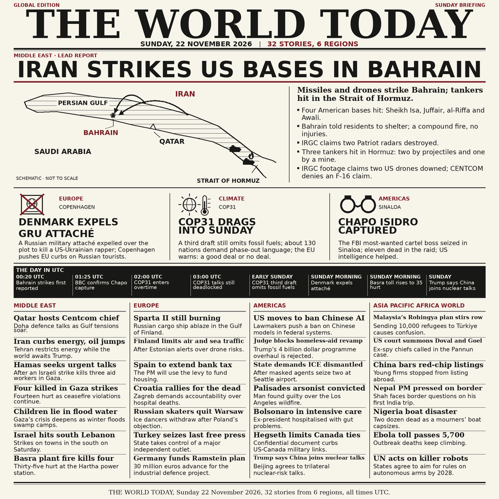

# THE WORLD TODAY — 22 November 2026

A dense newspaper front page presents the supplied Sunday 22 November 2026 world news in 32 distinct stories across six regions. A Persian Gulf schematic anchors the lead, three illustrated panels highlight major developments, and an eight-item UTC timeline sits above 28 briefs.

Run `python3 render.py` with Pillow installed to draw at 2048 × 2048 using the system DejaVu fonts, check text bounds and overlaps, and save the downsampled 1024 × 1024 `entry.png`. Rendering uses fixed content and geometry, with no network, randomness, or clock calls; `--output repeat.png` allows a second deterministic render in this directory.

Run `MAKEFUN_OUTPUT_DIR=./output node main.ts` with a Node version that supports TypeScript directly to copy the finished PNG into the requested directory and print its destination. The default output directory is `/output`; the entrypoint uses only Node built-ins and runs offline.

